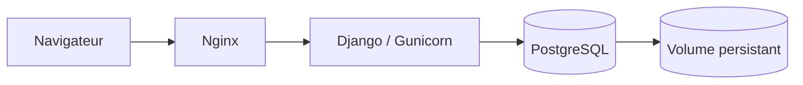

# ☕ Café Fidélité — Version 3

## Présentation

Café Fidélité est une application web de gestion des programmes de fidélité destinée à un réseau de cafés.

Ce projet est réalisé dans le cadre du cours **8INF228 — Adaptation et qualité des applications**, à l'Université du Québec à Chicoutimi (UQAC).

La version 3 introduit la gestion multisite, le partage des soldes entre succursales et une architecture conteneurisée utilisant PostgreSQL.

## Fonctionnalités

### Gestion des clients

- Création et recherche des clients.
- Consultation des soldes de fidélité.
- Consultation des cartes prépayées.
- Fusion des fiches clients.
- Anonymisation des renseignements personnels.

### Programme de fidélité

- Accumulation des étampes lors des achats payants.
- Attribution de récompenses selon une règle configurable.
- Utilisation des récompenses dans toutes les succursales.
- Conservation de l'historique des mouvements.
- Gestion des annulations.

### Cartes prépayées

- Émission de cartes de 11 cafés.
- Utilisation des cartes dans toutes les succursales.
- Consultation du nombre de cafés restants.
- Annulation des ventes et des consommations.

### Gestion multisite

- Création de nouvelles succursales sans modification du code.
- Affectation des employés aux succursales.
- Sélection de la succursale active.
- Partage des clients, des récompenses et des cartes prépayées.
- Identification de la succursale de chaque transaction.

### Rapports et administration

- Rapports statistiques par période.
- Rapports par succursale.
- Rapports globaux du réseau.
- Journal d'audit.
- Configuration des règles de fidélité.
- Gestion des permissions.

## Technologies utilisées

| Technologie | Utilisation |
|---|---|
| Python 3.13 | Langage de programmation |
| Django | Framework web |
| PostgreSQL 17 | Base de données de production |
| SQLite | Base de données de développement |
| Bootstrap 5 | Interface utilisateur |
| Django Crispy Forms | Gestion des formulaires |
| Docker Compose | Orchestration des conteneurs |
| Gunicorn | Serveur applicatif |
| Nginx | Proxy inverse |
| WhiteNoise | Gestion des fichiers statiques |
| Git et GitHub | Gestion des versions |

## Architecture

L'application sépare les responsabilités entre les modèles, les services métier, les vues et les interfaces utilisateurs.



Seul Nginx est accessible depuis l'ordinateur hôte, sur le port 8000.

Les conteneurs Django et PostgreSQL communiquent par les réseaux Docker.

## Installation en production locale

### Prérequis

- Git.
- Docker.
- Docker Compose V2.
- Python 3 pour la génération des secrets.

Les commandes doivent être exécutées dans le répertoire contenant `manage.py` et `docker-compose.yml`.

### 1. Configuration

Sous Linux ou macOS :

```bash
cp .env.example .env
```

Sous Windows PowerShell :

```powershell
Copy-Item .env.example .env
```

Cette opération doit uniquement être effectuée lors d'une nouvelle installation.

Générer les secrets de l'application :

```bash
python -c "import secrets; from pathlib import Path; p=Path('.env'); s=p.read_text(); s=s.replace('DJANGO_SECRET_KEY=CHANGE_ME', 'DJANGO_SECRET_KEY='+secrets.token_urlsafe(64)); s=s.replace('CHANGE_ME', secrets.token_hex(24)); p.write_text(s, encoding='utf-8')"
```

Ne pas régénérer ces secrets après l'initialisation de PostgreSQL sans mettre à jour les identifiants de la base existante.

Le fichier `.env` contient des informations sensibles et ne doit jamais être ajouté au dépôt Git.

### 2. Démarrage

```bash
docker compose up --build -d
```

Les migrations Django sont appliquées automatiquement au démarrage du conteneur applicatif.

### 3. Vérification

```bash
docker compose ps
```

Les trois services doivent être opérationnels :

- db
- app
- nginx

Application :

http://localhost:8000

Administration :

http://localhost:8000/admin/

Vérification de santé :

http://localhost:8000/health/

### 4. Données de démonstration

Pour une installation neuve destinée à la démonstration :

```bash
docker compose exec app python manage.py seed_demo_v3
```

Cette commande est destinée aux environnements de démonstration et ne doit pas être exécutée sur une base de production réelle.

Les données de démonstration comprennent deux succursales :

| Code | Établissement |
|---|---|
| CAFE01 | Café principal |
| CAFE02 | Café secondaire |

### Comptes de démonstration

| Rôle | Identifiant | Mot de passe | Succursale |
|---|---|---|---|
| Barista | `barista_demo` | `BaristaDemo2026!` | CAFE01 et CAFE02 |
| Gérant 1 | `gerant_demo` | `GerantDemo2026!` | CAFE01 |
| Gérant 2 | `gerant2_demo` | `Gerant2Demo2026!` | CAFE02 |
| Propriétaire | `proprietaire_demo` | `ProprietaireDemo2026!` | Ensemble du réseau |

Ces comptes sont exclusivement destinés à la démonstration de l'application.

Les identifiants et mots de passe définitifs doivent correspondre à ceux définis dans la commande `seed_demo_v3`.

### Clients de démonstration

| Client | Téléphone | Scénario |
|---|---|---|
| Alice Demo V3 | 4185550101 | Accumulation d'étampes dans les deux cafés et utilisation d'une récompense au café secondaire |
| Jean Demo V3 | 4185550102 | Achat d'une carte prépayée au café principal et consommation de trois cafés au café secondaire |
| Sophie Demo V3 | 4185550103 | Trois achats payants répartis entre les deux succursales |

Les transactions sont réparties sur plusieurs jours afin de permettre la démonstration des rapports statistiques par période et par succursale.

### 5. Administration technique

Pour créer un superutilisateur Django :

```bash
docker compose exec app python manage.py createsuperuser
```

Le superutilisateur est un compte d'administration technique distinct du rôle métier Propriétaire.

## Rôles et permissions

| Fonctionnalité | Barista | Gérant | Propriétaire |
|---|---|---|---|
| Enregistrer un achat | Oui | Oui | Oui |
| Utiliser une récompense | Oui | Oui | Oui |
| Émettre une carte | Oui | Oui | Oui |
| Annuler une transaction | Non | Sa succursale | Toutes |
| Consulter les rapports | Non | Sa succursale | Toutes |
| Fusionner les clients | Non | Non | Oui |
| Anonymiser les clients | Non | Non | Oui |
| Configurer la fidélité | Non | Non | Oui |
| Gérer les succursales | Non | Non | Oui |

Les permissions sont vérifiées côté serveur.

Les restrictions ne reposent pas uniquement sur les éléments visibles dans l'interface.

## Scénario de démonstration multisite

1. Se connecter avec le compte barista.
2. Sélectionner CAFE01.
3. Rechercher ou créer un client.
4. Enregistrer des achats payants.
5. Sélectionner CAFE02.
6. Retrouver le même client.
7. Utiliser une récompense disponible.
8. Émettre une carte prépayée dans une succursale.
9. Consommer un café prépayé dans l'autre succursale.
10. Vérifier les soldes globaux du client.
11. Se connecter avec le compte gérant et consulter les rapports locaux.
12. Se connecter avec le compte propriétaire et consulter les rapports du réseau.

## Tests automatisés

Les tests de l'application peuvent être exécutés contre PostgreSQL avec la commande :

```bash
docker compose exec app python manage.py test cafe_fidelite.loyalty.tests --verbosity=2
```

Les tests couvrent notamment :

- Les règles de fidélité.
- Les cartes prépayées.
- Les annulations.
- Les rapports statistiques.
- La fusion des clients.
- L'anonymisation.
- Les permissions.
- Les transactions multisites.
- Les restrictions d'accès entre succursales.

La suite de 94 tests a réussi lors d'une validation intermédiaire sous SQLite. Une nouvelle exécution est nécessaire pour confirmer les résultats après les dernières migrations et sous PostgreSQL.

## Consultation des soldes

Pour consulter les soldes des clients :

```bash
docker compose exec app python manage.py balances
```

Cette commande permet de vérifier les étampes, les récompenses disponibles et les cafés restants sur les cartes prépayées.

Les soldes sont globaux à l'échelle du réseau.

Pour consulter les options disponibles :

```bash
docker compose exec app python manage.py balances --help

```
# Ensemble du reseau
docker compose exec app python manage.py balances

# Premier cafe
docker compose exec app python manage.py balances --succursale CAFE01

# Deuxieme cafe
docker compose exec app python manage.py balances --succursale CAFE02

## Migration depuis la version 2

La version 3 conserve les migrations des versions précédentes.

Les données historiques sont associées à la première succursale, CAFE01.

La procédure de migration comprend :

1. La sauvegarde de la base SQLite V2.
2. La consultation des soldes avant migration.
3. L'application des migrations Django V3 sur une copie.
4. L'exportation des données.
5. L'importation dans PostgreSQL.
6. La comparaison des soldes avant et après migration.
7. La vérification des transactions historiques.

Consulter le document [Migration des données](docs/migration.md).

Ne pas charger les données de démonstration V3 avant d'avoir terminé la vérification des données historiques.

## Mode développement

Le mode développement utilise SQLite et une configuration distincte de la production.

### Installation des dépendances

```bash
uv sync
```

### Application des migrations

```bash
uv run python manage.py migrate --settings=config.settings.local
```

### Démarrage du serveur

```bash
uv run python manage.py runserver --settings=config.settings.local
```

L'application est accessible à l'adresse :

http://127.0.0.1:8000

### Tests en développement

```bash
uv run python manage.py test cafe_fidelite.loyalty.tests --settings=config.settings.local
```

Le serveur de développement ne doit pas être utilisé en production.

## Commandes Docker utiles

| Commande | Description |
|---|---|
| docker compose up --build -d | Construire et démarrer |
| docker compose ps | Vérifier les conteneurs |
| docker compose logs -f app | Consulter les journaux Django |
| docker compose logs -f db | Consulter les journaux PostgreSQL |
| docker compose stop | Arrêter les services |
| docker compose down | Supprimer les conteneurs et réseaux |
| docker compose up -d | Redémarrer les services |

Les données PostgreSQL sont conservées dans le volume nommé `postgres_data`.

Ne jamais utiliser `docker compose down -v` lorsqu'il faut conserver les données.

## Documentation

- [Document de conception](docs/conception.md)
- [Rétrospective de la V2](docs/retrospective-v2.md)
- [Procédure de migration](docs/migration.md)
- [Décisions architecturales — ADR](docs/adr/)
- [Déclaration d'utilisation de l'IA](AI-USAGE.md)

## Limites

L'application ne traite aucun paiement et ne fournit pas d'espace client.

Le déploiement est local et repose sur une seule instance applicative.

Le déploiement cloud, la réplication, l'équilibrage de charge et la configuration HTTPS publique ne font pas partie de cette version.

## État de validation

La validation finale du déploiement PostgreSQL et de la migration V2 vers V3 reste à compléter.

## Auteurs

Projet réalisé dans le cadre du cours 8INF228 — Adaptation et qualité des applications.

Université du Québec à Chicoutimi.

## Version

Café Fidélité — V3.