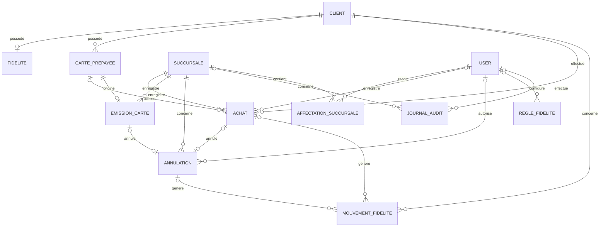
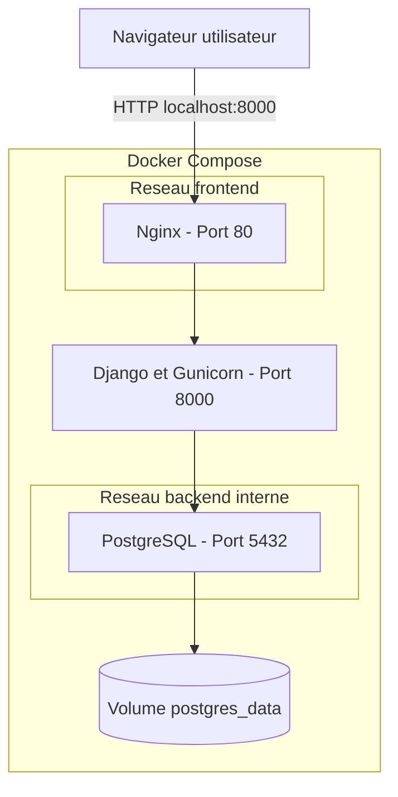

# Conception — Évolution vers la version 3

## 1. Objectif

La version 3 de Café Fidélité étend la version 2 afin de permettre la gestion de plusieurs succursales d'un même réseau de cafés.

Les fonctionnalités existantes sont conservées. Les principales évolutions sont :

- La gestion de plusieurs succursales.
- Le partage des clients et des programmes de fidélité.
- La gestion des permissions par succursale.
- L'introduction du rôle de propriétaire.
- La production de rapports locaux et globaux.
- Le remplacement de SQLite par PostgreSQL en production.
- La conteneurisation de l'application.

## 2. Architecture applicative

L'application conserve une architecture organisée autour de plusieurs responsabilités :

| Composant | Responsabilité |
|---|---|
| models.py | Modèle de domaine et contraintes d'intégrité |
| services.py | Règles métier et transactions |
| services_succursales.py | Gestion des accès aux succursales |
| views.py | Traitement des requêtes et contrôle d'accès |
| forms.py | Validation des formulaires |
| templates/ | Interfaces utilisateurs |
| admin.py | Administration du système |
| tests.py | Validation automatisée des fonctionnalités |

La logique métier reste séparée des interfaces afin de faciliter les évolutions futures.

## 3. Modèle de domaine V3

### 3.1 Nouveaux modèles

**Succursale**

Représente un café appartenant au réseau.

Attributs principaux :

- id
- nom
- code
- adresse
- active
- date_creation

Le code identifie chaque succursale de manière unique.

**AffectationSuccursale**

Représente l'affectation d'un employé à une succursale.

Attributs principaux :

- id
- employe
- succursale
- active
- date_affectation

Ce modèle permet de gérer les accès sans modifier directement la structure du compte utilisateur.

### 3.2 Diagramme du modèle de domaine

Une annulation concerne soit un achat, soit une émission de carte, mais jamais les deux simultanément.

Le diagramme présente les principales relations du domaine et ne représente pas toutes les relations secondaires héritées de la V2.

### 3.3 Données globales et locales

| Données globales | Données associées à une succursale |
|---|---|
| Clients | Achats payants |
| Soldes de fidélité | Utilisations des récompenses |
| Cartes prépayées | Consommations prépayées |
| Règles de fidélité | Émissions de cartes |
| Comptes utilisateurs | Annulations |

Les soldes de fidélité et les cartes prépayées appartiennent au client, indépendamment de la succursale.

Ainsi, un client peut accumuler des étampes dans un café et utiliser sa récompense dans un autre.

## 4. Gestion des permissions

Trois rôles métier sont définis.

| Fonctionnalité | Barista | Gérant | Propriétaire |
|---|---|---|---|
| Rechercher un client | Oui | Oui | Oui |
| Enregistrer un achat | Oui | Oui | Oui |
| Utiliser une récompense | Oui | Oui | Oui |
| Émettre une carte prépayée | Oui | Oui | Oui |
| Annuler une transaction | Non | Sa succursale | Toutes |
| Consulter les rapports | Non | Sa succursale | Toutes |
| Consulter le journal d'audit | Non | Sa succursale | Global |
| Fusionner des clients | Non | Non | Oui |
| Anonymiser un client | Non | Non | Oui |
| Modifier les règles de fidélité | Non | Non | Oui |
| Administrer les succursales | Non | Non | Oui |

Un barista peut être affecté à plusieurs succursales. Un gérant est affecté à une seule succursale active. Le propriétaire dispose d'un accès global.

### 4.1 Vérifications côté serveur

Les permissions sont vérifiées à plusieurs niveaux :

1. Authentification de l'utilisateur.
2. Vérification de son rôle.
3. Détermination des succursales autorisées.
4. Validation de la succursale active.
5. Vérification de l'appartenance de la transaction à la succursale autorisée.
6. Exécution de l'opération métier.

Les services métier effectuent également des vérifications afin de ne pas dépendre uniquement des contrôles effectués dans les interfaces.

Une modification manuelle d'un identifiant dans une URL ou un formulaire ne doit pas permettre de contourner les restrictions.

## 5. Gestion des transactions

Chaque transaction est associée à la succursale dans laquelle elle a été réalisée.

Les opérations qui modifient les soldes utilisent des transactions atomiques afin de préserver la cohérence des données.

Les annulations sont associées à la succursale de la transaction originale.

Les mouvements de fidélité et les journaux d'audit permettent de conserver la traçabilité des opérations.

## 6. Rapports statistiques

Deux niveaux de rapports sont disponibles :

- Rapport local : transactions d'une succursale.
- Rapport global : transactions de l'ensemble du réseau.

Les rapports utilisent la succursale associée aux transactions et excluent les opérations annulées.

Les soldes de fidélité restent globaux et ne doivent pas être additionnés plusieurs fois lorsque plusieurs succursales sont sélectionnées.

## 7. Architecture de déploiement

L'architecture de production locale repose sur Docker Compose et trois conteneurs :

- Nginx : proxy inverse.
- Django avec Gunicorn : serveur applicatif.
- PostgreSQL : serveur de base de données.

Le conteneur Django est connecté aux réseaux frontend et backend. PostgreSQL est uniquement connecté au réseau backend.

### 7.1 Ports et réseaux

| Service | Port interne | Port publié sur l'hôte |
|---|---|---|
| Nginx | 80 | 127.0.0.1:8000 |
| Django / Gunicorn | 8000 | Aucun |
| PostgreSQL | 5432 | Aucun |

Seul Nginx est directement accessible depuis l'ordinateur hôte.

### 7.2 Chemin d'une requête

1. L'utilisateur envoie une requête HTTP à Nginx.
2. Nginx transmet la requête à Gunicorn.
3. Django traite la requête et vérifie les permissions.
4. Django interroge PostgreSQL si nécessaire.
5. La réponse est retournée à l'utilisateur par Nginx.

### 7.3 Persistance

Les données PostgreSQL sont stockées dans le volume nommé postgres_data.

Ce volume permet de conserver les données lors de l'arrêt ou de la recréation des conteneurs, tant qu'il n'est pas supprimé.

### 7.4 Configuration et sécurité

La configuration de production repose sur des variables d'environnement.

Les secrets ne sont pas intégrés au dépôt Git ni à l'image Docker.

L'architecture prévoit également :

- DEBUG désactivé.
- Exécution de Django avec un utilisateur non privilégié.
- Vérifications de santé des conteneurs.
- Application des migrations au démarrage.
- Journaux sur la sortie standard.
- Gestion des fichiers statiques avec WhiteNoise.

Le déploiement public avec HTTPS est hors du périmètre de cette version.

## 8. Migration des données

Les migrations Django de la V3 prolongent celles de la V2.

Les transactions historiques sont associées à la première succursale, identifiée par le code CAFE01.

Le transfert vers PostgreSQL doit préserver les identifiants, les relations et les soldes des clients.

La procédure détaillée et les résultats de validation sont présentés dans le document migration.md.

## 9. Principes de conception

### Responsabilité unique — SRP

Les responsabilités liées aux transactions, aux permissions et à la présentation sont séparées.

### Ouvert/Fermé — OCP

L'ajout d'une succursale ne nécessite pas de modification du code métier. Une nouvelle succursale peut être créée à partir des fonctionnalités d'administration.

### Encapsulation

Les règles de fidélité et les opérations sensibles sont centralisées dans les services métier.

### Composition

Les affectations permettent d'associer les employés aux succursales sans créer une hiérarchie de classes utilisateurs pour chaque rôle.

## 10. Décisions architecturales

Les décisions de la V3 sont documentées dans les ADR suivants :

| ADR | Sujet |
|---|---|
| 0008 | Gestion des succursales et des affectations |
| 0009 | Partage des soldes et des cartes prépayées |
| 0010 | Rôles et permissions multisites |
| 0011 | Gestion globale des clients |
| 0012 | Rapports locaux et globaux |
| 0013 | Démarrage et migrations des conteneurs |
| 0014 | Gestion des fichiers statiques |

Consulter le [répertoire des ADR](adr/) pour les justifications détaillées.

## 11. Limites et état de validation

La version 3 ne traite aucun paiement et ne fournit pas d'interface destinée aux clients.

L'architecture est conçue pour une instance applicative locale, sans réplication ni équilibrage de charge.

La validation définitive du déploiement PostgreSQL, du transfert des données historiques et des tests automatisés en environnement conteneurisé reste à compléter.